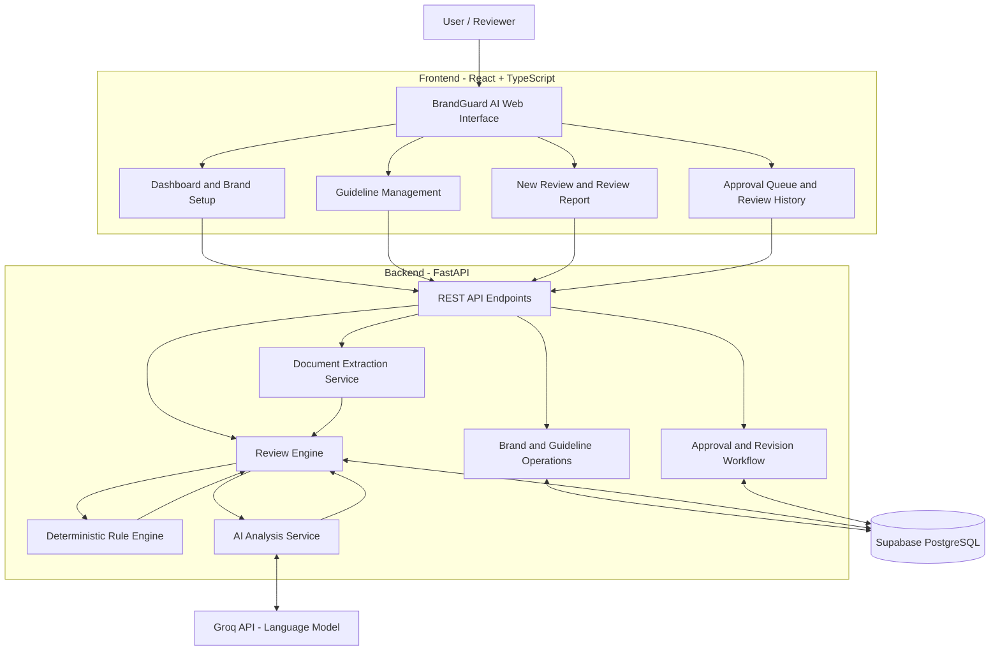
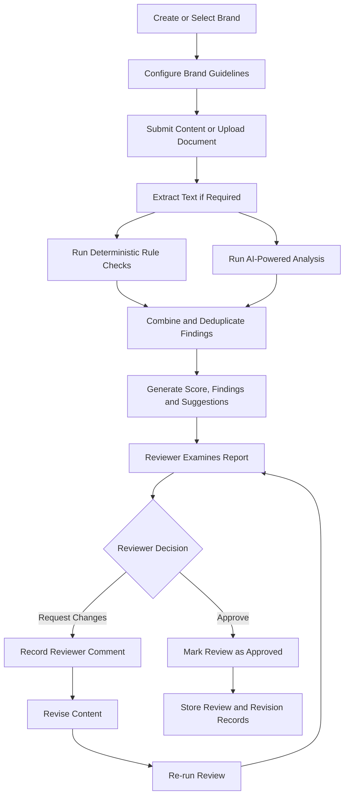
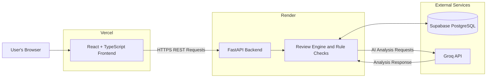
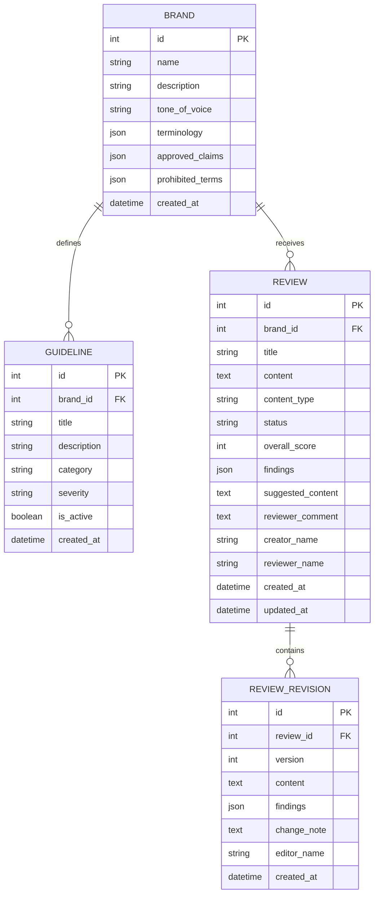

# BrandGuard AI

**AI-Powered Brand Compliance and Content Governance Platform**

BrandGuard AI helps organizations review marketing content against brand guidelines, approved claims, terminology, and compliance requirements. It combines deterministic rule-based checks with Large Language Model (LLM) analysis to identify potential issues, explain findings, suggest improvements, and support human approval workflows.

## Hackathon Project

BrandGuard AI was developed as part of a hackathon to address the challenge of brand compliance and content governance. The project demonstrates how AI-powered analysis and deterministic rule-based checks can help organizations identify potential content violations, maintain consistent brand messaging, and streamline human review and approval workflows.

## Table of Contents

- [Overview](#overview)
- [Key Features](#key-features)
- [Technology Stack](#technology-stack)
- [System Architecture](#system-architecture)
- [Content Review Workflow](#content-review-workflow)
- [Deployment Architecture](#deployment-architecture)
- [Database Design](#database-design)
- [Project Structure](#project-structure)
- [Getting Started](#getting-started)
- [Environment Variables](#environment-variables)
- [API Documentation](#api-documentation)
- [Testing](#testing)
- [Security Considerations](#security-considerations)
- [Future Improvements](#future-improvements)
- [License](#license)

## Overview

Organizations need to ensure that their marketing content follows brand identity, messaging guidelines, and compliance requirements. Manual content review can be time-consuming and may lead to inconsistent decisions.

BrandGuard AI provides a centralized workflow to configure brand guidelines, submit content, identify potential violations, review AI-generated findings, revise content, and record approval decisions.

The platform combines AI-powered analysis with deterministic checks to identify potential violations through explicit rules and contextual language analysis. Final approval remains under human control.

## Key Features

### 1. Brand Management
- Create and manage brands.
- Configure brand descriptions and tone of voice.
- Define approved claims and terminology.
- Maintain prohibited terms and expressions.

### 2. Guideline Management
- Create and manage brand-specific guidelines.
- Categorize guidelines by tone of voice, terminology, factual accuracy, accessibility, compliance, and general requirements.
- Assign severity levels.
- Activate or deactivate guidelines.

### 3. AI-Powered Content Review
- Submit content for analysis.
- Upload supported TXT, PDF, and DOCX documents.
- Run deterministic rule checks and AI-powered analysis.
- Generate an overall review score and findings.
- Receive suggested content improvements.

### 4. Explainable Findings
- Identify potential brand guideline violations.
- Display finding descriptions and severity levels.
- Highlight prohibited terminology and potentially unsupported claims.
- Help reviewers distinguish missing evidence from a claim that contradicts approved brand information when the available evidence supports that distinction.

### 5. Human Approval Workflow
- Review submitted content.
- Approve content or request changes.
- Record reviewer comments.
- Re-review revised content before approval.

### 6. Revision History
- Maintain content revision records.
- Track revision versions and findings.
- Support review traceability.

### 7. Governance Dashboard
- View brand and review statistics.
- Monitor pending and approved reviews.
- Track findings and high-severity issues.
- View review score summaries.

## Technology Stack

| Component | Technology |
|---|---|
| Frontend | React, TypeScript, Vite, CSS |
| Backend | Python, FastAPI |
| Database ORM | SQLAlchemy |
| Production Database | PostgreSQL with Supabase |
| Local Development Database | SQLite, when configured |
| AI Integration | Groq API and large language models |
| Document Processing | Python document extraction libraries |
| Frontend Deployment | Vercel |
| Backend Deployment | Render |

## System Architecture

BrandGuard AI follows a frontend-backend architecture. The frontend communicates with REST API endpoints exposed by FastAPI. The backend coordinates brand management, guideline management, document extraction, content review, and approval operations.

The review engine combines deterministic rule checks with AI-generated analysis. Application data is persisted in the configured database.



### Architecture Components

- **Frontend:** Provides the interface for brand configuration, guidelines, content submission, reports, approvals, and revision history.
- **FastAPI Backend:** Exposes REST endpoints and coordinates application operations.
- **Brand and Guideline Operations:** Manage brand details, terminology, approved claims, prohibited terms, and guidelines.
- **Document Extraction Service:** Extracts text from supported uploaded documents.
- **Deterministic Rule Engine:** Checks configured terminology, prohibited terms, and applicable guideline rules.
- **AI Analysis Service:** Uses the configured Groq language model to analyze content and generate findings and suggestions.
- **Review Engine:** Combines review results and produces the overall assessment.
- **Approval and Revision Workflow:** Records review decisions, comments, and revised content.
- **Supabase PostgreSQL:** Stores application records and revision history.

## Content Review Workflow

BrandGuard AI follows a structured content governance process.



### Workflow Explanation

1. The user creates a brand and configures its approved messaging and guidelines.
2. The user submits text or uploads a supported document.
3. The backend extracts document text when necessary.
4. The review engine executes deterministic checks and AI analysis.
5. The findings are combined into a report containing a score, explanations, severity, and suggested content where available.
6. A human reviewer examines the results and either requests changes or approves the content.
7. Revised content is reviewed again before approval.
8. Review and revision records are retained for subsequent reference.

## Deployment Architecture

The deployed application uses Vercel for the frontend, Render for the backend, and Supabase for PostgreSQL storage. The backend also communicates with the Groq API for AI-powered analysis.



### Deployed Application

- **Frontend:** https://brand-guard-ai-sigma.vercel.app/
- **Backend:** https://brandguard-ai-mnal.onrender.com
- **Interactive API Documentation:** https://brandguard-ai-mnal.onrender.com/docs
- **Health Endpoint:** https://brandguard-ai-mnal.onrender.com/health

The health endpoint checks backend responsiveness. A successful health response does not, by itself, verify database connectivity or AI functionality.

## Database Design

The application uses SQLAlchemy models to represent brands, guidelines, reviews, and review revisions.



### Relationship Summary

- A brand can have multiple guidelines.
- A brand can have multiple reviews.
- A review can have multiple revision records.
- Each review belongs to a brand.
- Each guideline belongs to a brand.

The diagram illustrates the logical data model. The actual database schema is defined by the SQLAlchemy models in the repository.

## Project Structure

```text
BrandGuard-AI/
├── backend/
│   ├── app/
│   │   ├── api/
│   │   │   ├── brands.py
│   │   │   ├── guidelines.py
│   │   │   ├── reviews.py
│   │   │   └── dashboard.py
│   │   ├── core/
│   │   │   └── config.py
│   │   ├── db/
│   │   │   ├── database.py
│   │   │   ├── models.py
│   │   │   └── init_db.py
│   │   ├── services/
│   │   │   ├── ai_service.py
│   │   │   ├── rule_engine.py
│   │   │   ├── review_engine.py
│   │   │   └── document_service.py
│   │   └── main.py
│   ├── requirements.txt
│   └── .env.example
├── frontend/
│   ├── src/
│   │   ├── api/
│   │   ├── pages/
│   │   ├── types/
│   │   ├── App.tsx
│   │   ├── App.css
│   │   ├── index.css
│   │   └── main.tsx
│   ├── package.json
│   ├── vercel.json
│   └── .env.example
└── README.md
```

## Getting Started

### Prerequisites

- Python 3.11 or another version compatible with the project dependencies
- Node.js and npm
- Git
- A Groq API key for AI-powered reviews

### 1. Clone the Repository

```bash
git clone https://github.com/Sumit182004/BrandGuard-AI.git
cd BrandGuard-AI
```

### 2. Set Up the Backend

From the project root, create a virtual environment:

```bash
cd backend
python -m venv .venv
```

Activate the environment.

**Windows:**

```bash
.venv\Scripts\activate
```

Install the dependencies:

```bash
pip install -r requirements.txt
```

Create a `.env` file inside the `backend` directory using `.env.example` as a reference.

Example local development configuration:

```env
APP_NAME=BrandGuard AI
ENVIRONMENT=development
DATABASE_URL=sqlite:///./brandguard.db
CORS_ORIGINS=http://localhost:5173
GROQ_API_KEY=your_groq_api_key
GROQ_MODEL=openai/gpt-oss-20b
```

Replace `your_groq_api_key` with your own API key. Never commit real credentials to GitHub.

Start the backend:

```bash
uvicorn app.main:app --reload
```

The backend should be available at:

`http://localhost:8000`

### 3. Set Up the Frontend

Open a second terminal from the project root:

```bash
cd frontend
npm install
```

Create a `.env` file inside `frontend`:

```env
VITE_API_URL=http://localhost:8000
```

Start the frontend:

```bash
npm run dev
```

Open the local URL printed by Vite, typically:

`http://localhost:5173`

### 4. Verify the Application

- Open the frontend in your browser.
- Visit `http://localhost:8000/health` to check backend responsiveness.
- Visit `http://localhost:8000/docs` to inspect available API endpoints.
- Create a brand and add guidelines.
- Submit content for review.
- Verify the report, approval workflow, and revision history.

## Environment Variables

| Variable | Description |
|---|---|
| `APP_NAME` | Application name |
| `ENVIRONMENT` | Development or production environment |
| `DATABASE_URL` | Database connection string |
| `CORS_ORIGINS` | Comma-separated list of allowed frontend origins |
| `GROQ_API_KEY` | Secret API key for Groq |
| `GROQ_MODEL` | Configured language model identifier |
| `VITE_API_URL` | Backend API base URL used by the frontend |

For production, configure environment variables through the deployment platforms rather than committing credentials to the repository.

Use the appropriate Supabase PostgreSQL connection string for the deployed backend. Set `CORS_ORIGINS` to the deployed frontend origin and `VITE_API_URL` to the deployed backend URL.

## API Documentation

FastAPI generates interactive API documentation automatically.

When running locally:

- **Swagger UI:** http://localhost:8000/docs
- **Health Check:** http://localhost:8000/health

The application exposes API groups for:

- Brand management
- Guideline management
- Content reviews and decisions
- Review revisions
- Dashboard statistics

Refer to the interactive API documentation for the current endpoint definitions and request schemas.

## Testing

Use the following scenarios to test the application.

### 1. Brand Management
- Create a brand.
- Configure terminology, approved claims, and prohibited terms.
- Refresh the page and confirm the brand remains available.

### 2. Guideline Management
- Add guidelines for compliance, tone of voice, and factual accuracy.
- Verify the selected categories and severity values.
- Confirm guidelines persist after refreshing.

### 3. Content Review
- Submit content containing prohibited terms and unsupported claims.
- Verify that the report includes findings and a score.
- Submit compliant content and compare the results.
- Confirm that missing evidence is not automatically treated as proof that a claim is false.

### 4. Approval Workflow
- Request changes to a review.
- Add a reviewer comment.
- Revise the content and submit it for re-review.
- Approve the revised review.
- Confirm the final status is `Approved`.

### 5. Revision History
- Verify that the original and revised content are stored as separate versions.
- Confirm the latest revision contains the updated review results.
- Refresh the page and check that revision history remains available.

### 6. Dashboard
- Verify the brand and review counts.
- Check pending and approved review statistics.
- Confirm findings and score summaries reflect stored review data.

### 7. Error Handling
- Submit empty content.
- Try an unsupported document format.
- Test invalid input values.
- Verify that errors are presented clearly rather than causing an application crash.

## Security Considerations

- Keep API keys, database credentials, and other secrets in environment variables.
- Do not commit `.env` files containing credentials.
- Restrict CORS to trusted frontend origins in production.
- Use secure database connections and appropriate database permissions.
- Validate uploaded documents and input data.
- Implement authentication and role-based authorization before using the application with sensitive business content in production.

## Future Improvements

Potential enhancements include:

- User authentication and role-based access control.
- More detailed audit logs and governance reports.
- Improved evidence verification for factual claims.
- Expanded guideline configuration and policy management.
- Additional document formats and content integrations.
- More comprehensive automated tests and monitoring.

## License

Specify the applicable license before distributing this project publicly.
